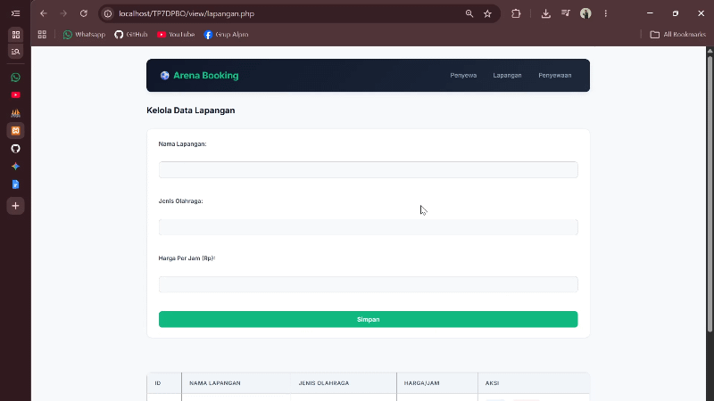
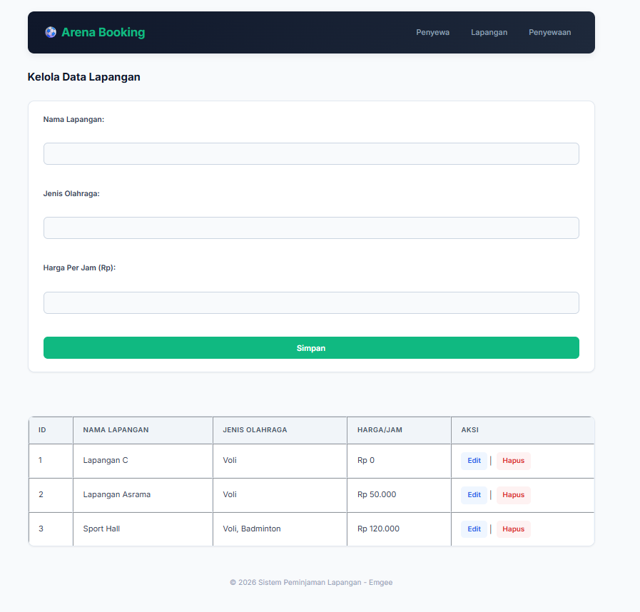
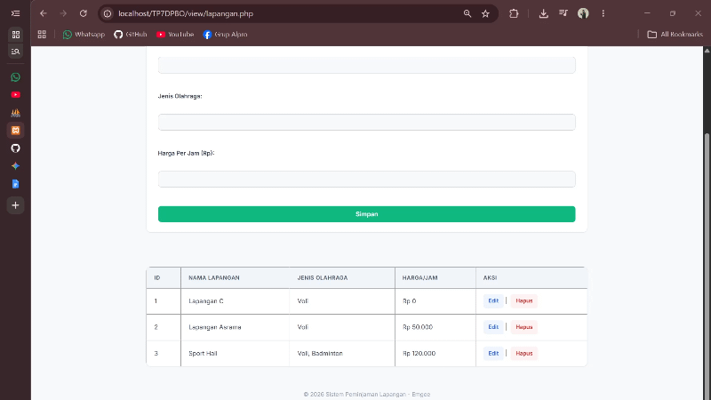
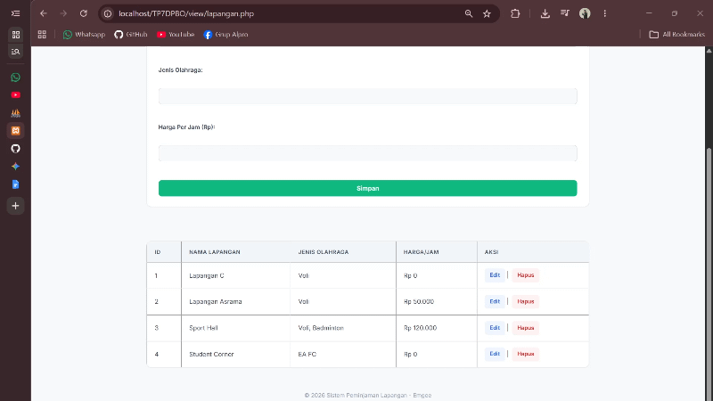
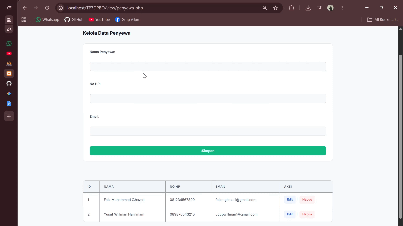
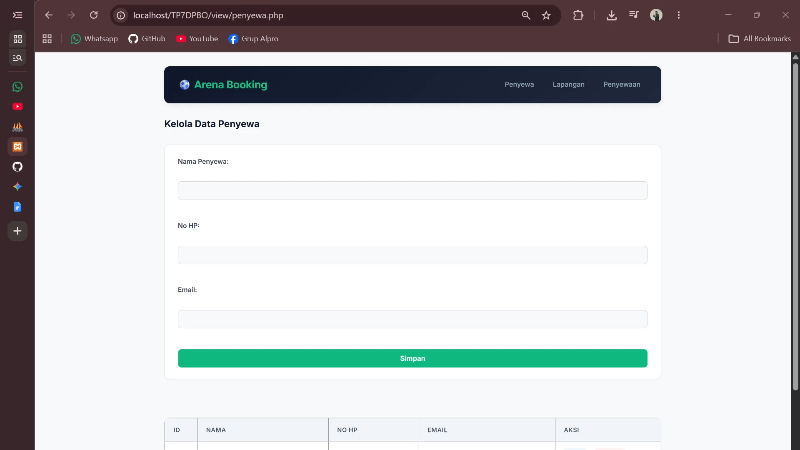
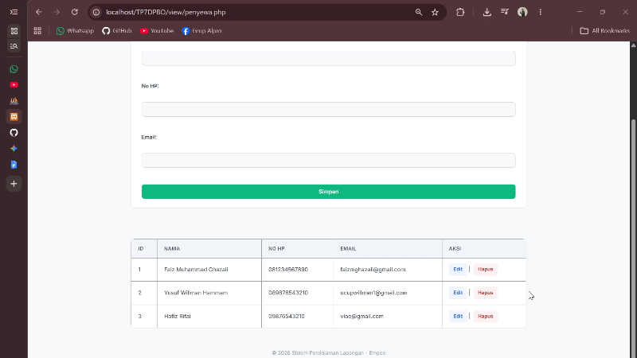
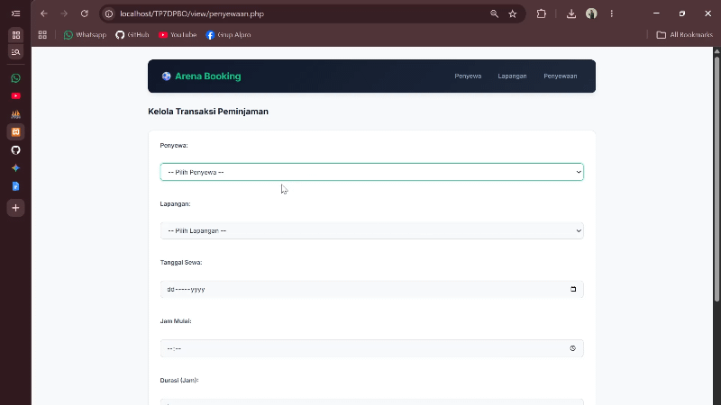
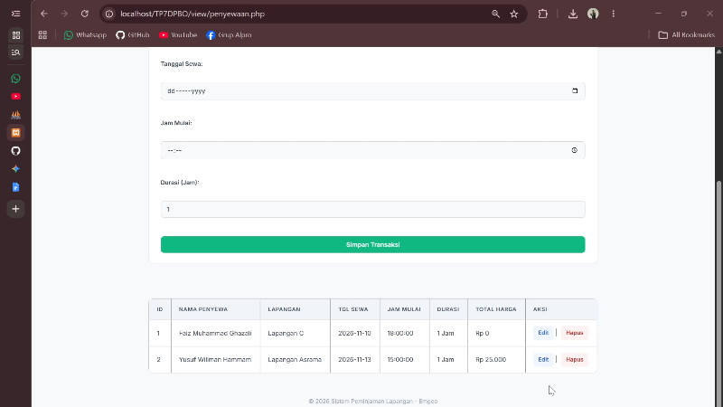

# TP 7 DPBO 25 26 C1 
OOP Dalam Website  

# Janji Integritas
Saya <strong>Faiz Muhammad Ghazali</strong> dengan <strong>NIM 2504531</strong> mengerjakan TP 7 dalam mata kuliah Desain dan Pemrograman Berorientasi Objek untuk keberkahanNya maka saya tidak melakukan kecurangan seperti yang telah dispesifikasikan. Aamiin.

# ⚽ Sistem Informasi Manajemen Penyewaan Lapangan (TP7 DPBO)

Dokumentasi resmi untuk tugas **TP7 DPBO** — Aplikasi Web Berbasis PHP OOP (Object-Oriented Programming) untuk mengelola data penyewaan lapangan olahraga.

---

## 📌 1. Tema Website

**Tema:** *Sistem Informasi Penyewaan Lapangan Olahraga (Sports Venue Booking System)*

Aplikasi ini dirancang untuk memudahkan pengelola lapangan olahraga dalam mencatat data master (lapangan & penyewa) serta mengelola transaksi penyewaan (booking) secara akurat. Dengan arsitektur berbasis **PHP OOP** dan visual yang responsif, aplikasi ini mendukung operasi **CRUD (Create, Read, Update, Delete)** menyeluruh untuk seluruh entitas.

---

## 💾 2. Penjelasan Database (`db_peminjaman.sql`)

Database bernama `db_peminjaman` terdiri dari **3 tabel utama** yang saling terhubung melalui relasi foreign key:

### 📑 1. Tabel `lapangan`
Menyimpan informasi master mengenai lokasi / arena lapangan olahraga.
| Field | Tipe Data | Keterangan |
| :--- | :--- | :--- |
| `id_lapangan` | `INT (Primary Key, Auto Increment)` | ID unik lapangan |
| `nama_lapangan` | `VARCHAR(100)` | Nama lapangan (misal: Lapangan Futsal A, Lapangan Badminton 1) |
| `jenis_olahraga` | `VARCHAR(50)` | Jenis olahraga (Futsal, Badminton, Basket, dll.) |
| `harga_per_jam` | `INT` / `DECIMAL` | Tarif sewa per jam |

### 📑 2. Tabel `penyewa`
Menyimpan data identitas pelanggan/penyewa.
| Field | Tipe Data | Keterangan |
| :--- | :--- | :--- |
| `id_penyewa` | `INT (Primary Key, Auto Increment)` | ID unik penyewa |
| `nama_penyewa` | `VARCHAR(100)` | Nama lengkap penyewa |
| `no_hp` | `VARCHAR(20)` | Nomor telepon / WhatsApp penyewa |
| `alamat` | `TEXT` | Alamat tempat tinggal penyewa |

### 📑 3. Tabel `penyewaan`
Tabel transaksi yang menghubungkan data `penyewa` dan `lapangan`.
| Field | Tipe Data | Keterangan |
| :--- | :--- | :--- |
| `id_penyewaan` | `INT (Primary Key, Auto Increment)` | ID unik transaksi penyewaan |
| `id_penyewa` | `INT (Foreign Key -> penyewa.id_penyewa)` | Referensi penyewa |
| `id_lapangan` | `INT (Foreign Key -> lapangan.id_lapangan)` | Referensi lapangan yang disewa |
| `tgl_sewa` | `DATE` / `DATETIME` | Tanggal dilaksanakannya sewa |
| `durasi_jam` | `INT` | Durasi sewa (dalam jam) |
| `total_harga` | `INT` / `DECIMAL` | Total biaya (Durasi $\times$ Harga per jam) |

---

## 🔄 3. Penjelasan Flow Kode & Struktur Folder

### 📁 Struktur Folder Project
```text
TP7DPBO/
├── class/
│   ├── Lapangan.php    # Class OOP untuk manajemen data Lapangan
│   ├── Penyewa.php     # Class OOP untuk manajemen data Penyewa
│   └── Penyewaan.php   # Class OOP untuk manajemen data Transaksi Penyewaan
├── config/
│   └── db.php          # Koneksi Database (Class DB / PDO / MySQLi)
├── database/
│   └── db_peminjaman.sql # Script SQL pembuatan database & tabel
├── view/
│   ├── header.php      # Template Navigasi dan Head HTML
│   ├── footer.php      # Template Footer HTML & Script JS
│   ├── lapangan.php    # View & Form CRUD Data Lapangan
│   ├── penyewa.php     # View & Form CRUD Data Penyewa
│   └── penyewaan.php   # View & Form CRUD Data Transaksi Penyewaan
├── index.php           # Controller utama / Router aplikasi
└── style.css           # Styling CSS kustom & Layouting
```

### 🔁 Flow Eksekusi Kode
1. **Inisialisasi (HTTP Request):** User mengakses `index.php` melalui browser dengan atau tanpa parameter (misal: `index.php?page=penyewa` atau `index.php?action=add`).
2. **Routing Controller (`index.php`):**
   * Memanggil `config/db.php` untuk membuka koneksi database.
   * Memuat class yang sesuai dari folder `class/` (`Lapangan.php`, `Penyewa.php`, atau `Penyewaan.php`).
3. **Eksekusi Logika & Query:**
   * Jika ada request `POST` (Tambah/Edit data), controller memanggil metode class terkait (misal: `$lapangan->createData($_POST)`).
   * Jika ada request `GET` aksi hapus, controller memanggil metode hapus (misal: `$penyewaan->deleteData($_GET['id'])`).
4. **Rendering Template (View):**
   * Controller memuat `view/header.php`.
   * Controller memuat halaman spesifik sesuai konteks `page` (`view/lapangan.php`, `view/penyewa.php`, atau `view/penyewaan.php`).
   * Controller menutup render dengan `view/footer.php`.

---

## 🚀 4. Panduan Menjalankan Website

### Requirements:
* Web Server (XAMPP / WAMP / Laragon)
* PHP 7.4 atau PHP 8.x
* MySQL Database

### Langkah-langkah Setup:
1. **Clone / Copy Project:**
   Pindahkan folder `TP7DPBO` ke dalam direktori web server Anda (`htdocs` jika menggunakan XAMPP, atau `www` jika Laragon).
   * Path: `C:/xampp/htdocs/TP7DPBO`
2. **Import Database:**
   * Buka browser dan akses `http://localhost/phpmyadmin`.
   * Buat database baru dengan nama `db_peminjaman`.
   * Pilih database tersebut, lalu klik menu **Import**.
   * Pilih file `TP7DPBO/database/db_peminjaman.sql` dan klik **Go / Import**.
3. **Konfigurasi Koneksi Database:**
   Pastikan konfigurasi host, user, password, dan nama database pada `TP7DPBO2526C1/config/db.php` sudah sesuai dengan environment lokal Anda.
4. **Akses Website:**
   Buka browser dan ketikkan alamat:
   ```text
   http://localhost/TP7DPBO2526C1/
   ```

---

## 🧪 5. Dokumentasi Pengujian Fitur CRUD

Seluruh fungsi CRUD telah diuji dan berfungsi secara optimal di semua modul:

### 🟢 1. Modul Lapangan 

* **Create (Tambah):** Mengisi nama lapangan, jenis olahraga, dan harga per jam $\rightarrow$ Data tersimpan ke tabel `lapangan`.


* **Read (Tampil):** Menampilkan daftar tabel lapangan beserta detail tarif.


* **Update (Edit):** Mengubah data tarif/nama lapangan melalui form edit modal/halaman.


* **Delete (Hapus):** Menghapus data lapangan dari database (terproteksi jika ID lapangan sedang digunakan pada transaksi penyewaan).


### 🟢 2. Modul Penyewa 

* **Create (Tambah):** Menambahkan data penyewa baru (Nama, No HP, Alamat).


* **Read (Tampil):** Menampilkan daftar penyewa dalam bentuk tabel rapi.


* **Update (Edit):** Mengupdate data identitas atau nomor HP penyewa.


* **Delete (Hapus):** Menghapus data penyewa dari database.


### 🟢 3. Modul Transaksi Penyewaan (`?page=penyewaan`)

* **Create (Tambah):** Memilih dropdown Penyewa & Lapangan, memasukkan tanggal sewa dan durasi sewa. Sistem secara otomatis menghitung `total_harga` ($\text{durasi} \times \text{harga\_per\_jam}$).


* **Read (Tampil):** Menampilkan relasi gabungan (JOIN query) yang memuat nama penyewa, nama lapangan, tanggal sewa, durasi, dan total harga.


* **Update (Edit):** Mengubah detail transaksi sewa (misal menambah durasi sewa atau mengganti lapangan).


* **Delete (Hapus):** Membatalkan/menghapus catatan transaksi penyewaan.

---
